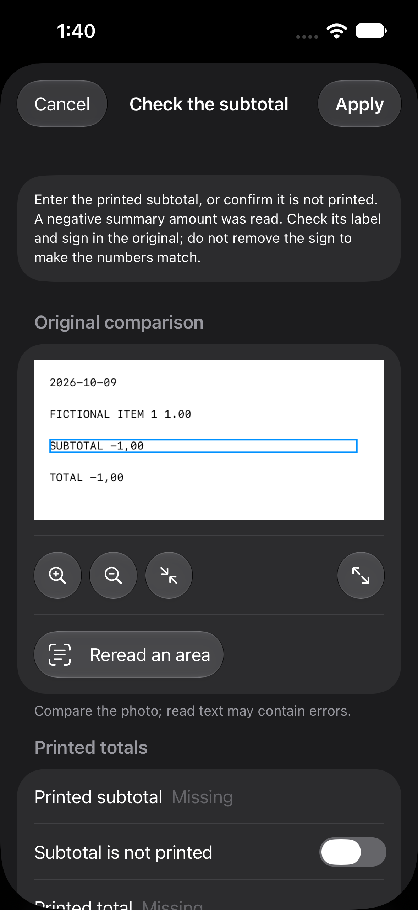
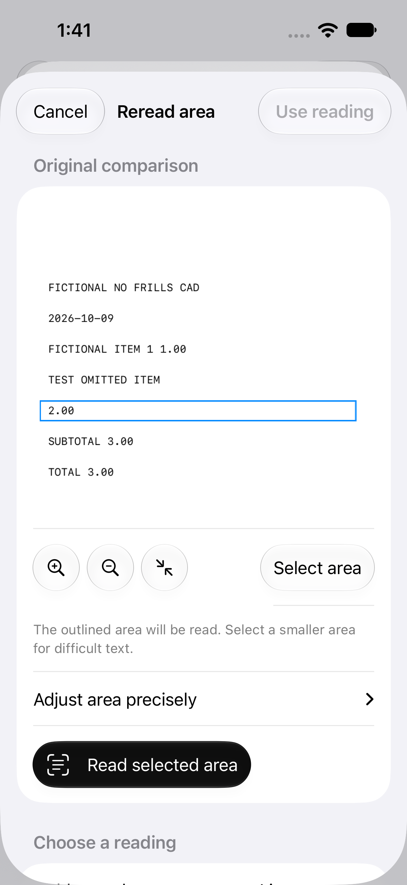

# P5-05 — Focused corrections

2026-10-17. Approved in Main; complete as a bounded correction-flow task. Connect uncertain extraction evidence to scoped correction, without changing automatic recognition.

## Changes

Merchant and currency conflicts now lead to receipt details. Signed, ambiguous and unreadable summary warnings lead to the corresponding subtotal or total editor. Missing-field checks retain the warning explanation and original source highlights instead of creating a duplicate unhighlighted task. All linked initial-read text remains available.

For an unassigned row, choose an existing line or add a purchase before rereading. The reread flow then offers that line's amount, description or quantity. It cannot mistakenly open merchant/summary rereading for an unassigned purchase. New lines and nested readings remain working-copy changes until Apply; Cancel discards them.

Changing currency reopens affected monetary/source checks. Existing saved monetary acknowledgments may reopen once because their signatures now include currency. Values and evidence remain intact. Independent original review and exact reconciliation are still required to finish; a focused correction never confirms the whole receipt.

## Verification

- 60 focused native tests passed across guidance, corrections, assisted reading, workflow and currency context.
- 18 scorer tests passed.
- Three signed Simulator UI tests passed: highlighted signed-summary correction in dark mode; choosing a line before rereading an unassigned row; actual fictional-image Vision rereading with nested Cancel and explicit Apply.
- Screenshots below are fictional fixtures, inspected in light and dark mode. They contain no private receipt evidence.

The first native attempt exposed an outdated fictional merchant header and a test using the wrong signed-summary syntax; fixtures were corrected. An unsigned UI build could not access its test wallet; the final UI run used an ad-hoc-signed Simulator build with the T05Workflow scheme. The first private-run launch had a missing temporary test bundle; it was rebuilt before retrying. Earlier evidence is retained and is not counted as successful verification.

## Existing-receipt regression result

Two private hosted methods passed: ten actual-app imports, five stable repeat pairs, five draft save/reopen checks and two checked-text replays. All five drafts retain identical fields and source memberships; all five raw OCR texts/geometries and both checked transcripts remain unchanged. Generated observation IDs naturally differ between imports.

All 81 actionable warnings have their source IDs represented in guidance, grouped into 21 checks (16 with linked evidence). This measures routing coverage, not correctness or human effort. Strict exact purchase pairs remain 43/66; legacy pairs 53/66; subtotals 4/4 and totals 3/5. There are no lost correct fields or new unmatched proxies. No automatic accuracy gain is claimed.

## Scope and limits

This milestone improves correction routing, not automatic OCR or parser accuracy. No human correction session on real receipts or human-effort timing was measured. Simulator automation duration is not user correction time or physical-phone latency. The five existing purchases are exposed development data; there are zero held-out purchases. P5-06 requires separate approval for the full evaluation.

No normal Simulator wallet or physical-phone installation was updated.

## Evidence

[Aggregate](evidence/p5-05/aggregate.json) · [Validation](evidence/p5-05/validation.json)

Private frozen run: `private-receipts/evaluation/p5-05-final-v3`. Use `evaluation/receipt-corrections/run.py` prepare/collect/verify with the dedicated `Sliplet P5-05 Correction Lab` device and a Sliplet build-for-testing product. Raw captures/logs and reference hashes stay private. UI tests separately use T05Workflow with Simulator ad-hoc signing.
