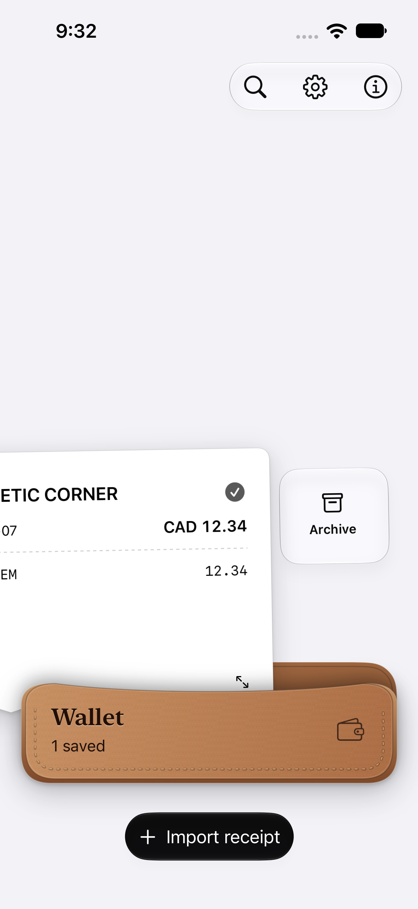
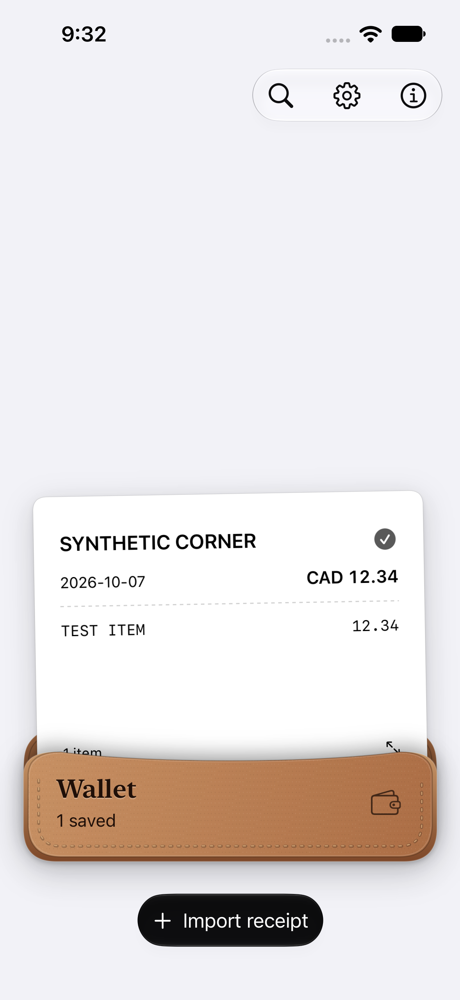
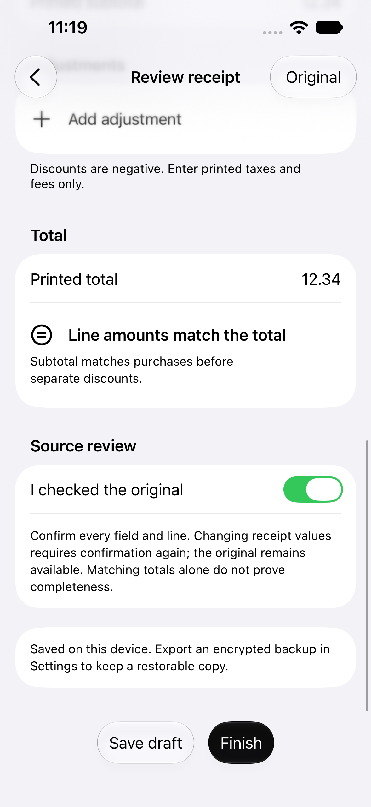
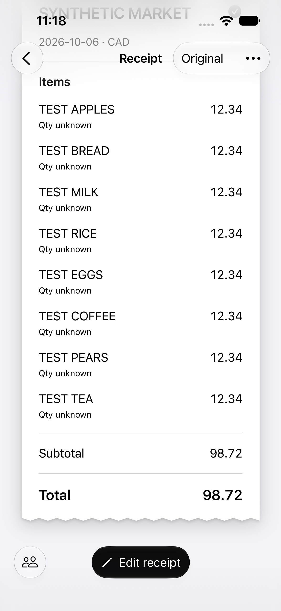
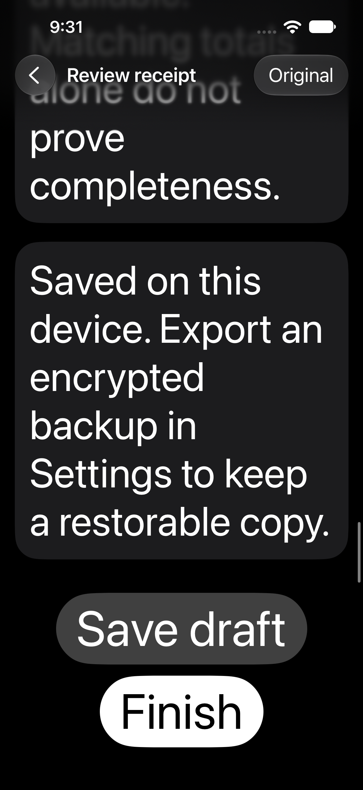
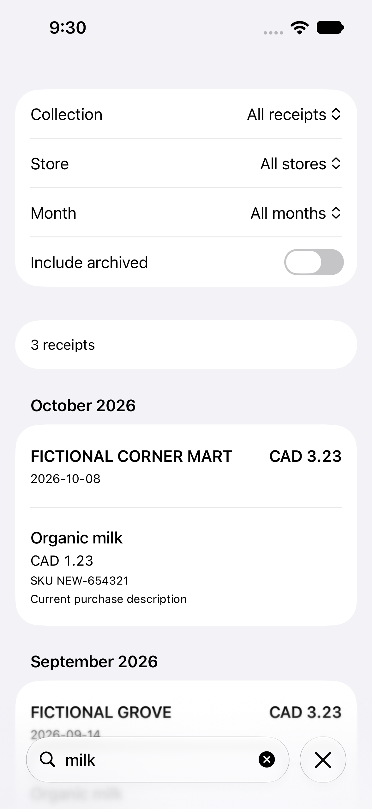
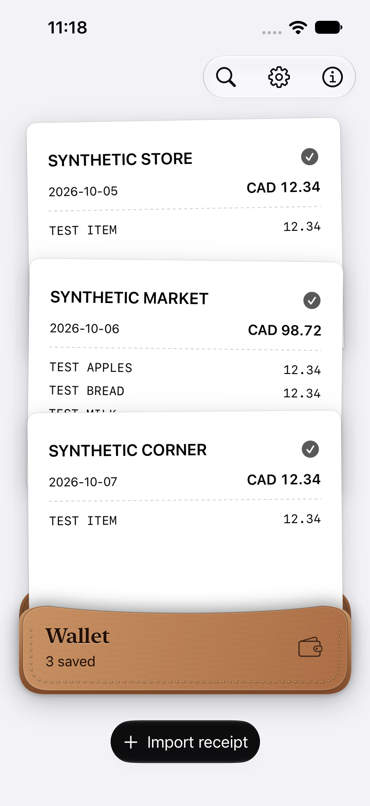

# Phase 3 UX verification

Fictional, isolated iPhone 15 Pro / iOS 27.0 Simulator data only. No private photos, OCR, labels or receipt values are included. [Repair plan](../../PHASE3_UX.md) · [phone walkthrough](../../PHONE_WALKTHROUGH.md).

- [Test ledger](tests.json): original two failures, all intermediate scoped results and final 13/13 native + 147 unit / one hardware skip. Latest outcomes of 30 distinct native methods pass; repeated cases are not added to the distinct count. Earlier failures remain visible.
- [Validation](validation.json): data/source preservation, measured 500-record cache behavior, warning diagnosis and physical/toolchain limits.
- [Release](release.json): signed 0.3/build 4, stable bundle and local-team match, no phone installation.
- [Source hashes](source-hashes.json) and [capture provenance](captures.json): final app/test/resources and explicitly fictional screenshots.

UI commands use `DEVELOPER_DIR=/Applications/Xcode.app/Contents/Developer scripts/test-ui.sh` with the task-created UUID and explicit `-only-testing` scopes, `-derivedDataPath /tmp/sliplet-p3-build` and separate `/tmp/sliplet-p3-*.xcresult` bundles. Unit verification uses scheme Sliplet with `-only-testing:SlipletTests`; Release uses generic/platform=iOS and `/tmp/sliplet-p3-release`. The runner is uninstalled after UI runs. The task-created Simulator is removed only after evidence export; pre-existing Simulators and the phone are untouched.

The final native run covers review-state retention/real changes/no-op Finish, reverse and disabled-side swipes, large dark controls, preserved long-reader scrolling, five strict structural screens, history/match/source behavior, same-ID split save and repeated wallet/appearance transitions. Earlier scoped passes additionally cover camera, app lock, real native Files picker lifecycle, organization, dates and large collections. All structural audit callbacks return false for findings; no blanket waivers. The unit priority warning and Xcode diagnostic-collector limitations are retained. Physical FPS, camera/VoiceOver usability and phone acceptance remain pending.

## Selected captures

